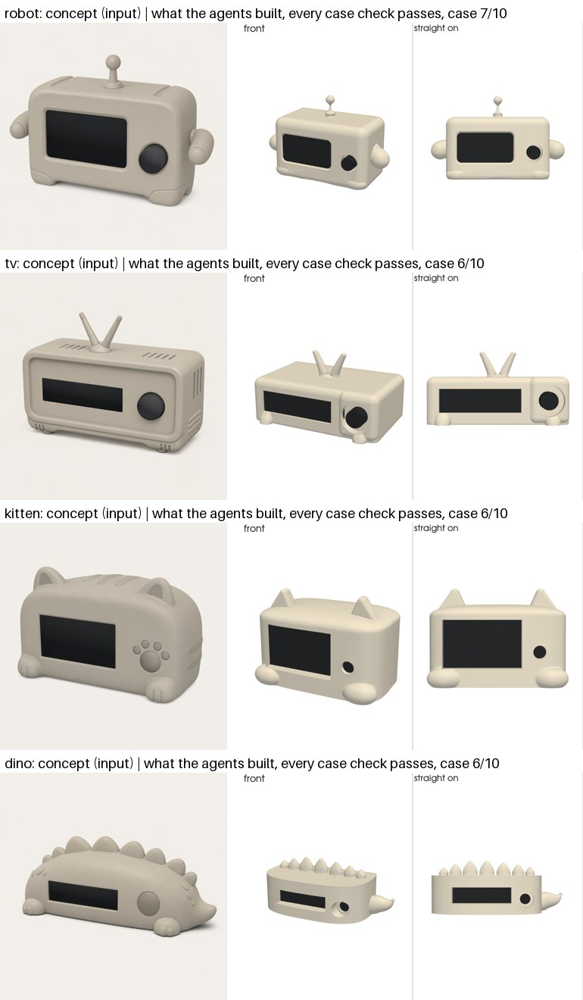
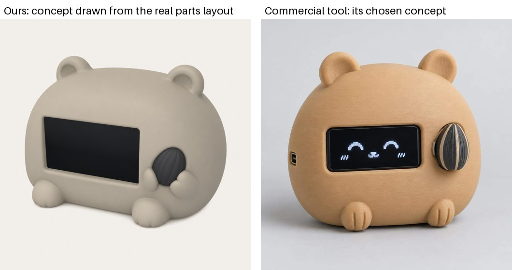
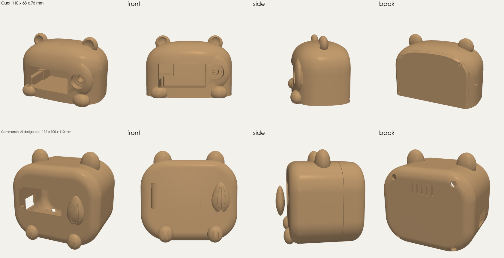
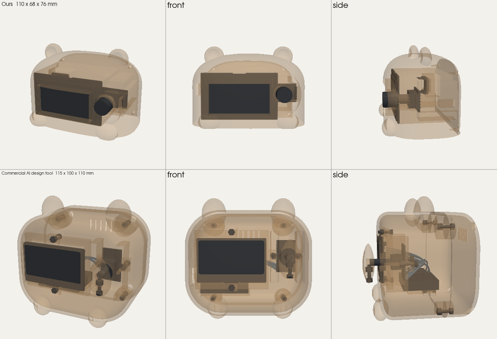

# Enclosure agents

The enclosure generator can design a character case with two agents instead of one AI call per try. A body agent
shapes the outside; a case agent builds the working inside within that body. Each agent calls small tools, fixed rules
judge every result, and the agent decides its next step. The live pipeline still uses the one-shot loops: the agents
run from a test runner until they pass every check, reach 8/10 and win a blind look comparison.

Code: `enclosure/harness.py` (the shared loop), `body_agent.py`, `case_agent.py`, `agent_pipeline.py`,
`body_parts.py` and `case_parts.py` (the building blocks), `body_rules.py`, `case_checks.py` (the rules).
Guides the agents read: `enclosure/guides/body.md`, `enclosure/guides/case.md`.

## The flow

```
design file + parts
  -> concept picture, drawn from the real parts layout (concepts.agent_picture)
  -> body agent: main form (two candidates, the review picks one) -> features, one kind per build -> flat back
       rules: sealed, size, the parts' room, back plate, features; look reviews: proportions, character gate, submit
  -> frozen BODY.step
  -> case agent: place parts -> openings -> screws and stops -> outside; 300+ checks; look review
  -> if no working case fits: the case's reasons go back to the body agent for one more body (agent_pipeline)
  -> the best attempt, labelled done / draft (fits, look goal not met) / failed
```

## The loop (harness.py)

- One saved script per agent: `write` once, then `edit(old, new)` and `show(section)`; a snapshot after every working
  run. Only the latest built file can be checked or submitted.
- Every failed result is marked `{"ok": false, "kind", "source"}` (crash, rule, refused, limit). A crash names the
  helper and the operation it failed in and whose fault it is: `script` (the agent's code, or a helper refusing its
  values) or `tool` (a shared block broke). A failure is never shortened.
- Circuit breaker: the same shared-tool failure after one retry stops the run as "blocked by tool", keeps the best
  pass and saves the exact script to `tool_bugs/` as a regression case. A run that dies without output is reported as
  the machine, not the script.
- The same call on the same file with the same failure is flagged and not counted.
- Looking (`docs`, `show`, `render`, `recall`) costs no build step, up to 40 calls.
- Long results are stored and shortened to a reference (`recall(ref)`); past 30k input tokens the agent writes a
  handoff and continues on a fresh chain. State is saved after every step, so a stopped run resumes.

## The building blocks

- Main forms: `superblob` (rounded: roundness, top, shoulder), `spine_body` (a body that flows into a tail or nose),
  `soft_box`. Every setting works: out-of-range values are brought in, a band too low to round becomes straight sides,
  and each change prints a "note" saying what was built and why. Range tests cover hundreds of settings.
- Features: `grow(body, name, at, profile, ...)` grows ears, horns, fins, tails and snouts out of the body with a
  flared base, tilted to the surface.
- Inside: `place_screws` and `place_stops` put fasteners on spots that fit, spread to the corners, never typed in.
- The body brief carries a space report: how much room the main form has beyond the parts on each axis, in mm, with
  tight designs flagged.

## How it is tested

- Unit tests for every block over its whole range, for the loop (marked failures, the breaker, resume) and for the
  rules. `enclosure/regressions/` holds real scripts that once broke a helper; each must build.
- Tuning designs (kitten, robot, TV, dino) may be used to tune the tools. Held-back test designs are frozen before any
  run and never tuned on; a change must fix a failure seen on at least two tuning designs.

### Running test generations (agents and people)

Run each test generation in its own container with the cloud task's limits, not as a process on your machine:

```sh
docker build --platform linux/amd64 -f enclosure/Dockerfile -t makeable-enclosure .    # once, from the repo root
docker run --rm --memory=8g --cpus=4 --env-file .env -v "$PWD/enclosure/runs:/app/enclosure/runs" \
  makeable-enclosure python -W ignore <runner> <design.json> runs/<out>                  # one container per run
```

- Why: on AWS every job is a fresh Fargate task with 4 vCPU and 8 GB (`infra/enclosure.yml`). Several runs as plain
  processes share and exhaust the machine's memory (six at once crashed a 32 GB laptop), and they hide a run that would
  be killed at 8 GB in the cloud (one local run's process reached 9.9 GB). A container per run starts clean, cannot
  starve the others, and is stopped at the same limit as the cloud.
- Run at most two at a time on a 32 GB machine (2 x 8 GB plus the system).
- A run killed for memory is a real failure to fix (exit 137), not a flaky run.
- `--env-file` passes the keys without printing them; never echo or commit `.env`.

## Results so far

All four tuning designs now give a working case (every case check passes) on the parts-based concepts. The look is
6-7/10, short of the 8/10 goal.



### Against a commercial AI design tool

The same new design (a hamster: Seeed XIAO ESP32-S3, 2.42-inch SSD1309 OLED, KY-040 knob) and the same parts went
through both. The starting pictures:



Both results drawn the same way (printed parts, same colour, lights and cameras), then see-through with the parts:




An independent review judged ours worse overall: the look clearly (a bare knob shaft in a raised boss and a stepped
screen opening, against a printed seed knob and a recessed screen frame), fit and function too (no stop behind the
knob, an open slot next to it, wires visible through it), printability about even (ours is two parts and prints flat),
and completeness (the other tool also delivers firmware, a manual and a costed parts list). Our "every check passes"
hid 64 warnings, some of them real faults.

## Next

1. Turn the warnings that are real faults into failures: `press_stop`, `case_closed`, `wire_hidden`, `knob_room`, `wall`.
2. A printed knob cap on the 6 mm D shaft.
3. A recessed, rounded screen frame and button trims; a rounded USB opening.
4. Rounding per direction, so each edge rounds as much as its own spare room allows.
