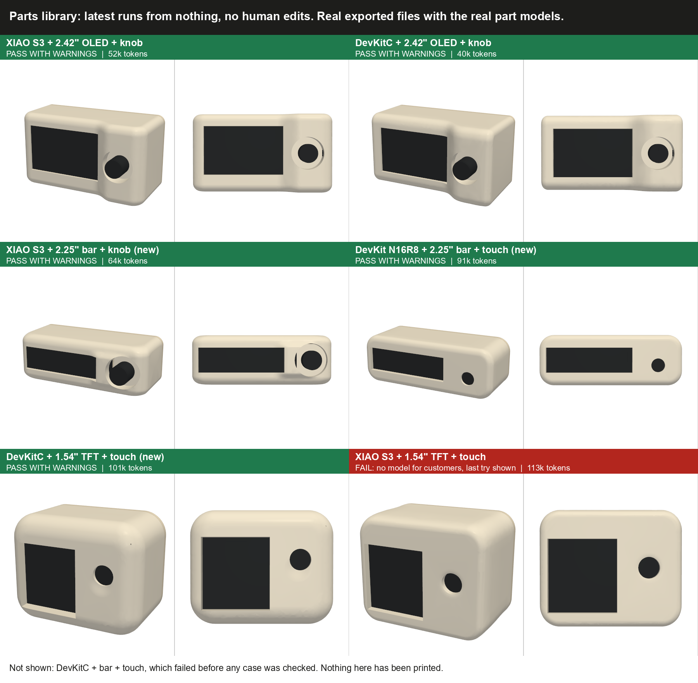

# Enclosure parts library

How the enclosure generator builds the inside of a case from tested pieces, why it was built, the rules it follows, and how it was tested. The code is in `enclosure/`. This is an experiment on `feat/enclosure-parts-library`, stacked on `feat/enclosure-agent`, and nothing in the site uses it yet.

## Why

The first generator let an AI write every holder, post and opening from scratch on each run. It worked on the parts it was tuned on, but each run invented new geometry, so it made new mistakes: long thin bars on the rear cover, posts in a part's path, parts colliding on the way in. Runs cost about 160k to 230k tokens.

The fix is the split the product already uses: the AI chooses, plain code builds and checks. The AI designs the outside and decides where parts go. Tested code builds everything inside.

## The flow

```text
 Parts + wiring (hand-written base design for now)
   |
   v
 Access list, plain code: what must reach the outside
 Needed space, plain code: the smallest body the parts fit in
   |  cannot fit -> stop before any paid call, with the reason
   v
 AI designs the outer body, checked against the concept picture
   |  body back must be flat, so the cover prints
   v
 AI places parts and calls library pieces (case_parts.py)
   |  a piece refuses an unsafe result with a clear error
   v
 Fixed checks measure the exported files
   |  fail -> errors go back to the AI, with stop rules
   v
 PASS -> model    PASS WITH WARNINGS -> model + print checklist    FAIL -> no model, the reason
```

## The pieces

All in `enclosure/case_parts.py`. Sizes come from the part cards through `parts_data.json`, so no piece contains code for one part.

| Piece | What it builds | What it refuses |
|---|---|---|
| `Part` | Places a real part, turning it without changing its size | A turn that is not square |
| `pocket` | The room a part needs in the Shell, including its plugs | It only widens toward the back, so a part always has a straight path in |
| `window`, `shaft_hole`, `knob_recess`, `touch_opening`, `usb_opening` | Fitted openings | A touch opening outside the sensor's outline |
| `tower`, `tower_room` | A holder for the controller built into the rear cover, and its room in the Shell | |
| `stop` | A column from the cover to just behind a part | A stop through another part or past the part's outline. It thickens by itself when long |
| `Screw` | A post, pilot hole, clearance hole and screwdriver path | A post in a part's path or outside the body |
| `free_spots`, `stop_spots` | Every position a post or stop can use | |
| `wire_paths` | Guide paths for the wires | |
| `finish` | Exports the parts and writes `design.json` with the build order | A part that is not one solid |

The AI can pass different arguments or write its own piece. The same checks measure the result either way.

`case_example.py` is a full case built only from these pieces. It is sent to the AI as the worked example, and a test runs it through the real checks, so the brief cannot teach something broken.

## Rules

**Build order.** Parts go into the Shell from the back. The rear cover carries the controller's holder and closes last.

**Access.** Decided in `enclosure/access.py`, with no AI.

| Gets an opening | Stays inside, with room around it |
|---|---|
| Screen | Boot and reset buttons |
| Knob, button, touch sensor | Ports the project does not use, such as Ethernet |
| Power (USB), unless the project has a battery | A camera the project does not use |
| A part marked as needing to see outside | |

A must-pass check confirms each item has a clear straight path out. The catalog has no battery parts yet, so the battery rule is only unit tested. Later, the agent should show this list and ask the user to confirm it.

**Printing.** Every printed part needs a flat side on the print bed, and the rear cover must be at least 90% flat. Gaps between mating parts are at least 0.1 mm. Only the Shell and the flat back of the cover may form the outside.

**Glue.** A board that sits in its holder may be glued, if plastic is within 0.5 mm on one side. A part you press or touch needs a real stop.

## How it was tested

Runs start from nothing on `gpt-6.1-sol`, with nobody stepping in. To avoid tuning the library to a few parts, some part combinations were held back and run only after the code was frozen.

| Stage | Parts | Passed | Tokens per run |
|---|---|---|---|
| Before the library | 4 tuning designs | 4 of 4 | 164k to 230k |
| Library, first version | Same 4 | 4 of 4 | 47k to 66k |
| Library, first version | 3 held-back designs | 0 of 3 | 0k (stopped early), 103k, 127k |
| After fixes | 3 new held-back pairings | 2 of 3 | 71k to 89k |
| After keeping pieces inside the body | 4 tuning designs | 2 of 4 | 40k to 113k |
| After keeping pieces inside the body | 3 new held-back pairings | 3 of 3 | 64k to 101k |

Across the 11 most recent library runs, 8 passed, about 73%, at about 76k tokens per run on average. The old system averaged about 197k on the tuning designs.



The two tuning designs that failed in the last round are both tight fits: a 37 mm tall front and a 68 mm wide body. The stricter checks refused the layouts the AI tried, and it used up its crash budget. No bad case reached the output.

What the held-back runs found, and the general fix for each:

| Found | Fix |
|---|---|
| The holder hit a socket that overhangs the board's edge | The holder clears everything that sticks out, and a test fits it to every controller card |
| The needed space ignored the controller's length | It now counts the controller's full size |
| The AI guessed post and stop positions and was refused | `free_spots` and `stop_spots` list the positions that work |
| Posts landed outside the curved body | `Screw` and `free_spots` check the body |
| The holder broke through the side wall and showed as a patch | A check confirms only the Shell and the cover's back form the outside. A refusal inside `tower_room` was tried and removed: it was stricter than the real checks and blocked a tight design that passed before |

Each fix is a rule for any case, not a number set for one board. Fixes found on held-back parts make those parts no longer an unbiased test, so each round uses new pairings.

## Release bar

It will never pass every time, and adding a rule after every failure does not converge: each fix exposed the next problem. So the bar is about safety and cost, not a perfect pass rate.

| Measure | Bar | Now |
|---|---|---|
| Bad cases shipped | Never: a must-pass failure gives no model | Met |
| Pass rate per run | About 70% | About 73% over the last 11 runs |
| Cost per run | Well below the old system | About 76k tokens, against 197k |
| Failures | A plain reason, and an automatic retry | Met, in `generate.py` |

New rules come only from real problems, such as a test print or a customer report, not from failures in test runs.

## Failures and retry

`enclosure/generate.py` handles one customer request. It runs the generator, and if the run fails it retries once with a fresh outer body. A design whose parts cannot fit is not retried, because a second try cannot change that. The result is written to `runs/jobs/<job>.json`:

| Status | What the customer gets |
|---|---|
| PASS | The model |
| PASS WITH WARNINGS | The model and a print checklist |
| FAIL | No model, and a plain reason, such as "The last design still failed these checks: parts collide on the way in." |

If each run passes about 73% of the time and the two tries were independent, two tries would pass about 93% of the time. They are not fully independent, so that is an upper estimate.

A real retry was run on the DevKitC + bar + touch design: both tries failed, 129k tokens in total, and the customer result read "No case was made ... It was tried 2 times." Both tries hit the same wall: the controller holder needs nearly the full 37 mm height, and the curved body has none to spare. The needed-space estimate does not allow for rounded corners, so this design passed the early fit check and the retry could not help.

## Known limits

- Nothing from the library has been printed. Gap, wall and holder sizes are starting values to set from a real print.
- A new part needs a hand-written part card.
- Base designs are still hand-written. The planned interface asks the user questions and produces them.
- A tall, narrow front can leave no room for screws and supports. A long bar screen with a knob failed this way.
- The screen-size rule refuses very small screens before any run. Whether to relax it is open.
- The controller is usually glued in its holder.
- The Shell is more solid than the AI-written version, so it uses more plastic.
- Generated code runs on a local stand-in. Production needs an isolated task per try.

## Running it

From `enclosure/`, with `OPENAI_API_KEY` in `.env`:

```text
.venv/Scripts/python -W ignore generate.py base_designs/<design>.json <job name>
.venv/Scripts/python -W ignore agent.py base_designs/<design>.json - <run name>
.venv/Scripts/python -W ignore -m unittest test_case_parts test_rules test_layout test_agent test_card test_checks test_wiring test_knob test_generate
```

`generate.py` is one customer request with retry. `agent.py` is a single run.

A base design asks for the library with `"use_library": true`. Results are saved under `enclosure/runs/agent/<run name>/`, which is not committed.
